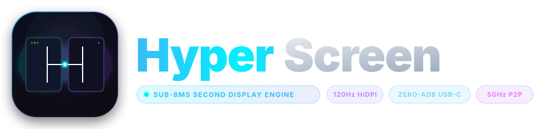

<p align="center">
  
</p>

<p align="center">
  
</p>

<p align="center">
  <b>Next-Generation Sub-8ms Mac ↔ Android Second Display &amp; Audio Engine (USB-C &amp; Wireless)</b><br>
  <sub>120Hz/144Hz HiDPI • 48kHz Stereo Audio • Zero-ADB AOA v2 • Decoupled 240Hz Cursor • AIMD Adaptive Bitrate • S-Pen Stylus</sub>
</p>

<p align="center">
  <a href="https://asiddeen.github.io/hyperscreen/"></a>
  <a href="https://github.com/asiddeen/hyperscreen/releases"></a>
  <a href="https://github.com/asiddeen/hyperscreen/actions"></a>
  <a href="#-hardware-pipeline-latency-budget"></a>
  <a href="#-key-architectural-advantages"></a>
  <a href="#2-low-latency-48khz-mac-audio-streaming"></a>
  <a href="#1-zero-adb-plug-and-play-usb-c-iousbhost--usbaccessory-aoa-v2"></a>
  <a href="LICENSE"></a>
  <a href="CONTRIBUTING.md"></a>
  <a href="https://deepmind.google"></a>
</p>

---

HyperScreen turns any modern Android tablet or phone (Android 11+ / API 30+) into a hardware-accelerated, high-fidelity **120Hz/144Hz HiDPI extended display with synchronized 48kHz stereo system audio** for Apple Silicon and Intel Macs running macOS 14.0+ (Sonoma/Sequoia).

It supports ultra-low-latency **USB-C (Zero-ADB AOA v2 + High-Speed Loopback)** and **Wireless LAN (UDP + Sliding-Window GF($2^8$) FEC + Bonjour Discovery)** with real-time adaptive bitrate congestion control and seamless live hotplug handover.

🌐 **Live Showcase & Documentation**: [https://asiddeen.github.io/hyperscreen/](https://asiddeen.github.io/hyperscreen/)

---

## ⚡ Hardware Pipeline Latency Budget

HyperScreen achieves glass-to-glass presentation latency under 8ms through a zero-copy, hardware-accelerated execution pipeline:

| Pipeline Stage | Implementation | Measured Budget |
| :--- | :--- | :--- |
| **1. Desktop Capture** | macOS `ScreenCaptureKit` + Direct `IOSurfaceRef` zero-copy memory tap | ~1.2 ms |
| **2. Hardware Encode** | Apple Silicon `VideoToolbox` (HEVC Main Profile, CBR, zero frame reordering) | ~1.8 ms |
| **3. Transport Serialization** | Zero-copy kernel bulk transfer (`IOUSBHost` / AOA v2) or MTU-sliced UDP datagrams | < 0.5 ms |
| **4. Network Transfer** | Direct USB 3.2 Gen 1/2 bulk loopback (`127.0.0.1:9453`) or local Wi-Fi 6 | < 0.5 ms |
| **5. Hardware Decode** | Android NDK `AMediaCodec` / `LowLatencyMediaCodec` directly to Surface buffer | ~3.2 ms |
| **Total Pipeline Presentation Latency** | **Synchronized End-to-End Decode & Render** | **~6.7 ms (< 8 ms)** |

---

## 📊 Architecture & Protocol Comparison

Rather than relying on generic screen-mirroring apps or high-latency TCP screen scrapers, HyperScreen is built from the ground up on modern OS multimedia and kernel I/O primitives:

| Capability | HyperScreen Pro | Standard ADB Mirroring | TCP Virtual Display Apps | Legacy Remote Desktop (VNC/RDP) |
| :--- | :--- | :--- | :--- | :--- |
| **Pipeline Latency** | **< 8 ms** | 20 – 35 ms | 35 – 50 ms | 60 – 100+ ms |
| **Max Refresh Rate** | **120Hz / 144Hz HiDPI** | 60Hz (Frame Capped) | 60Hz | 30 – 60Hz (Variable) |
| **USB Transport** | **Zero-ADB AOA v2 + Loopback** | Requires ADB & USB Debugging | Virtual Network Adapter | TCP Port Forwarding |
| **System Audio** | **48kHz Stereo PCM (sub-10ms)** | No Audio / Desynced | 50 – 80 ms (Buffered) | High Latency / Desynced |
| **Packet Loss Handling** | **0ms GF($2^8$) Cauchy FEC** | TCP packet retransmit drop | TCP head-of-line stall | Full connection stall |
| **Stylus & S-Pen** | **Pressure + Tilt + 1-Euro Filter** | Mouse click emulation | Touch only / Paid tier | Mouse click emulation |
| **Hotplug Handover** | **Zero-Downtime Live Switch** | Disconnects & crashes | Connection reset | Session terminated |

---

## 🌟 Key Architectural Advantages

```
Mac Host (ScreenCaptureKit + VideoToolbox)               Android Client (MediaCodec + AudioTrack)
┌────────────────────────────────────────┐               ┌───────────────────────────────────────┐
│ • macOS System Audio Capture (48kHz)   │ ── Audio PCM ─▶ • LowLatencyAudioPlayer (sub-10ms)     │
│ • Hardware HEVC Encoding (120Hz)       │ ── Video NALU ─▶ • LowLatencyMediaCodec (stage fallback)│
│ • AIMD Dynamic Bitrate Control         │ ◀── RTT Ping ── • Real-time Telemetry Loop             │
│ • USB / Wi-Fi Transport Engine         │ ◀── Hotplug ─── • Seamless USB ↔ Wi-Fi Handover        │
│ • Multi-Host Bonjour Advertisement     │ ◀── Selection ─ • Multi-Host Selector Dialog           │
└────────────────────────────────────────┘               └───────────────────────────────────────┘
```

### 1. Zero-ADB Plug-and-Play USB-C (`IOUSBHost` ↔ `UsbAccessory` AOA v2)
- **Direct AOA v2 Negotiation**: Negotiates Android Open Accessory v2 directly from macOS user space. Plugging in the USB-C cable automatically wakes and launches HyperScreen via `<usb-accessory>` intents without requiring Android Developer Options or USB debugging.
- **Zero-GC NDK I/O**: Streams over dedicated kernel bulk endpoints using zero-copy C++20 file descriptor I/O.
- **Zero-Lag ADB Loopback (`127.0.0.1:9453`)**: Preserves and coexists alongside ADB reverse tunnels without port collisions or interface resets.
- **Live USB $\leftrightarrow$ Wi-Fi Handover**: Plugging in the USB cable during Wi-Fi streaming immediately promotes the session to USB-C; unplugging falls back gracefully to Wi-Fi without resetting the virtual display.

### 2. Low-Latency 48kHz Mac Audio Streaming
- **Native ScreenCaptureKit Audio Tap**: Captures clean macOS system audio at 48kHz stereo without third-party kexts, virtual soundcards, or audio loopback drivers.
- **Sub-Microsecond Conversion**: Converts 32-bit float PCM to 16-bit linear PCM in real time and streams packed `hs_audio_header_t` (`0x04`) frames.
- **Non-Blocking Playback**: Rendered on Android via [`LowLatencyAudioPlayer`](android-client/app/src/main/java/dev/hyperscreen/client/LowLatencyAudioPlayer.kt) with `AudioTrack.PERFORMANCE_MODE_LOW_LATENCY` and non-blocking writes (`WRITE_NON_BLOCKING`), guaranteeing that audio delivery never introduces frame drops into the video pipeline.
- **Mac Menu Bar Toggle**: Dedicated "Stream Mac Audio to Tablet" toggle in macOS menu bar with instant mute/unmute control.

### 3. Real-Time Telemetry & AIMD Adaptive Bitrate (ABR)
- **Round-Trip Latency Tracking**: Lightweight C++ `hs_telemetry_ping_t` packets continuously measure network RTT between Mac and tablet.
- **Dynamic Bitrate Adjustment**: Host-side AIMD congestion control automatically scales video bitrate between 8 Mbps and 55 Mbps based on real-time Wi-Fi conditions.
- **In-Stream Glassmorphic HUD**: Displays live stats in both expanded and collapsed views:
  - **Expanded**: `⚡ 120 FPS • 3.2ms • 16.5Mbps` *(with packet loss counter)*
  - **Collapsed**: `⚡ 120 FPS ▾`

### 4. Zero Head-of-Line Blocking Wireless (`UDP + 0ms GF(2^8) FEC`)
- **MTU-Sliced Datagrams**: Slices video frames into 1380-byte datagrams protected by Cauchy Matrix Forward Error Correction (FEC).
- **0ms Instant Loss Recovery**: Reconstructs dropped packets on-the-fly without waiting for retransmission round-trips.
- **Rate-Limited NACK/IDR Pacing**: Emits at most 1 PLI NACK per 100ms on Wi-Fi, paired with host-side 250ms minimum IDR spacing to eliminate packet burst storms.

### 5. Multi-Host Wi-Fi Disambiguation & 1-Tap Switcher
- **Bonjour mDNS Discovery**: Automatically advertises and detects multiple Macs advertising `_hyperscreen._udp`.
- **Reactive Multi-Host Badges**: Overlays live count badges (`● MacBook Pro (2 Macs found • Tap to switch)`).
- **Interactive Host Picker**: One-tap selection dialog displaying name, IP, port, and `★ Saved` profile markers.

### 6. 240Hz Decoupled Hardware Vector Cursor & Pro Input
- **Decoupled Vector Cursor Plane**: Transmits 20-byte cursor state packets at 240Hz, smoothed via a speed-adaptive **1-Euro Filter** on Android. Suppressed automatically during video streaming where macOS ScreenCaptureKit composites the hardware cursor.
- **Full S-Pen & USI Stylus Support**: Routes `TOOL_TYPE_STYLUS` to native macOS `CGEvent` Tablet Pointer events (`Pressure`, `Tilt X/Y`, `Hover`, plus Android `MotionEventPredictor`).
- **Collapsible Mac Modifier Bar**: Floating glass modifier keys (`Cmd`, `Opt`, `Ctrl`, `Shift`, `Esc`) for quick desktop navigation.

---

## 🏗️ Repository Architecture

HyperScreen is organized as a unified monorepo:

| Directory | Language | Description |
| :--- | :--- | :--- |
| [`core/`](core/) | C/C++20 | Shared zero-copy wire protocol, CRC-16 CCITT, GF($2^8$) FEC, and 1-Euro cursor filter. |
| [`macos-host/`](macos-host/) | Swift 6 / Obj-C / C++20 | Native macOS host menu bar app, `CGVirtualDisplay`, ScreenCaptureKit, VideoToolbox, and Network.framework. |
| [`android-client/`](android-client/) | Kotlin / NDK C++20 | Modular Android client (`MediaCodec`, `AudioTrack`, `UnbufferedInputHandler`, AOA transport). |
| [`docs/`](docs/) | HTML5 / CSS3 / Vanilla JS | Responsive static landing page and interactive documentation for GitHub Pages. |
| [`.github/workflows/`](.github/workflows/) | GitHub Actions CI/CD | Automated CI matrix for C++20 unit tests, macOS `.app`/DMG build, and Android APK assembly. |
| [`scripts/`](scripts/) | Zsh | Automation for packaging, official releases, version bumping, and git hooks. |
| [`assets/`](assets/) | Vector / PNG | Official brand assets, dark/light SVG logos, macOS `.icns`, and Android adaptive mipmaps. |

---

## 🚀 Quick Start Guide

### macOS Host Installation

#### Option A: DMG Installer
Download `HyperScreen-1.5.4-macOS.dmg` from [Releases](https://github.com/asiddeen/hyperscreen/releases), open the disk image, and drag **HyperScreen.app** to your `/Applications` folder.

#### Option B: Build from Source
```bash
# Package, sign, benchmark, and run the macOS app
zsh scripts/package_macos_app.sh
```

---

### Android Client Installation

#### Option A: Install via ADB
```bash
# 1. Install debug APK
adb install -r android-client/app/build/outputs/apk/debug/app-debug.apk

# 2. Activate zero-lag USB-C loopback tunnel
adb reverse tcp:9453 tcp:9453
```

#### Option B: Build from Source
```bash
cd android-client
JAVA_HOME="/Applications/Android Studio.app/Contents/jbr/Contents/Home" ./gradlew assembleDebug
```

---

## 🔧 Hardware Codec & OS Guardrails

- **Samsung Exynos & Qualcomm MediaCodec Safety**:
  - `MediaFormat.KEY_OPERATING_RATE` is strictly guarded and never set to `Short.MAX_VALUE (32767)`, preventing `NO_MEMORY (0xfffffff4)` crashes during decoder initialization.
  - Multi-stage resolution fallback: `1920x1200 @ 90/120Hz` $\to$ standard `1920x1200` $\to$ `1280x800`.
- **Android 15+ 16KB Page Size**:
  - NDK native libraries link with `-Wl,-z,max-page-size=16384` for forward compatibility with 16KB memory page Android kernels.
- **macOS VideoToolbox Invariants**:
  - Strictly monotonic `CMTime` timestamps fed to `VTCompressionSessionEncodeFrame`.
  - Enforced 1.0-second maximum keyframe interval duration with a 350ms static desktop refresh timer so newly connected tablets immediately receive SPS/PPS/VPS + IDR frames.

---

## 🔄 Versioning & Release Automation

HyperScreen enforces strictly monotonic build codes and [Conventional Commits](https://www.conventionalcommits.org/):

- **Single Source of Truth**: Root [`VERSION`](VERSION) defines the active semantic version (`MAJOR.MINOR.PATCH`).
- **Dynamic Monotonic Build Codes**: Both macOS `CFBundleVersion` and Android `versionCode` are calculated as:
  $$\text{Build Code} = (\text{Major} \times 100000) + (\text{Minor} \times 10000) + \text{Git Commit Count}$$
- **Automated Official Releases**:
  Releases are strictly gated behind Git tags (`v*`). Normal commits to `main` trigger CI tests but never publish releases. To trigger an official release:
  ```bash
  # Automatically analyze Conventional Commits, test, bump VERSION, tag, and publish to GitHub:
  zsh scripts/release.sh auto

  # Or specify bump type manually:
  zsh scripts/release.sh [patch|minor|major]
  ```
- **Git Hooks**: Pre-commit hooks in `.githooks/` automatically bump and amend version on commit. Activate with:
  ```bash
  zsh scripts/install_git_hooks.sh
  ```

---

## 🛠️ Testing & Benchmarks

Run the complete test suite locally:

```bash
# 1. C/C++20 Core Protocol & FEC Unit Tests
cmake -B build -S core -DBUILD_TESTING=ON && cmake --build build && ctest --test-dir build --output-on-failure

# 2. Hardware VideoToolbox Loopback Benchmark
build/HyperScreen.app/Contents/MacOS/HyperScreenHost --benchmark-loopback
```

---

## 🤝 Contributing

Contributions are welcome! Please read our [**Contributing Guide**](CONTRIBUTING.md) for details on code style, hardware invariants, Conventional Commits, and how to submit pull requests.

---

<p align="center">
  <sub>Engineered with precision using <b>Google DeepMind Antigravity</b>. Released under the <a href="LICENSE">MIT License</a>.</sub>
</p>
