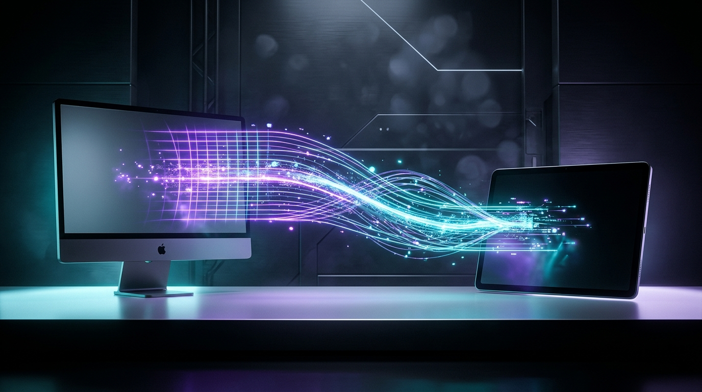

  

  

  <b>Next-Generation Sub-8ms Mac ↔ Android Second Display Engine (USB-C & Wireless)</b> 
  120Hz/144Hz HiDPI • Zero-ADB AOA v2 • Direct 5GHz Wi-Fi P2P • Decoupled 240Hz Cursor • Stylus Pressure &amp; Tilt

  
  
  
  

---

HyperScreen turns any Android tablet or phone (Android 11+ / API 30+) into a true, hardware-accelerated, 120Hz/144Hz HiDPI extended display for macOS (macOS 14.0+ Sonoma/Sequoia) over **USB-C (Zero-ADB AOA v2 + CDC-NCM/ADB Fallback)** and **Wireless (UDP + Adaptive FEC & Direct 5GHz P2P)**.

---

## Key Architectural Advantages Over SideScreen & OpenDisplay

1. **Zero-ADB Plug-and-Play USB-C (`IOUSBHost` ↔ `UsbAccessory` AOA v2):**
   - Unlike SideScreen (which requires users to enable Developer Options, toggle USB Debugging, and install Homebrew `adb`), HyperScreen negotiates **Android Open Accessory v2 (AOA)** directly from macOS user space via `IOUSBHost`.
   - Plugging in the USB-C cable automatically wakes and launches the HyperScreen Android app via `<usb-accessory>` intent filters and streams over dedicated kernel bulk endpoints using zero-GC C++ NDK file descriptor I/O.
   - Includes an automatic self-healing fallback to **CDC-NCM (USB Ethernet)** and **Embedded ADB** for OEM ROMs or hubs that restrict AOA.
2. **Zero Head-of-Line Blocking Wireless (`UDP + Sliding-Window FEC + 5GHz P2P`):**
   - Replaces TCP video streaming with MTU-sliced (`1380 B`) UDP datagrams protected by SIMD-accelerated XOR / Cauchy Matrix Forward Error Correction (FEC) and instant NACK/PLI recovery.
   - Includes **Direct 5GHz P2P Mode** (`LocalOnlyHotspot` / Wi-Fi Aware) so wireless streaming works on airplanes, trains, and corporate/cafe networks with AP Client Isolation.
3. **Hybrid 120Hz Motion + "Text-Sharp" Idle Refinement:**
   - Streams ultra-low-latency 120Hz HEVC/AV1 during window dragging and scrolling, then automatically emits a high-precision **Text-Sharp Refinement Frame** within 100ms of screen settling (eliminating 4:2:0 color subsampling blur on IDE syntax highlighting) before pausing capture at 0 fps when static.
4. **240Hz Decoupled Hardware Cursor Plane (1-Euro Filter Smoothing):**
   - Strips the cursor from the encoded video stream and transmits 20-byte cursor state packets at up to 240Hz with cached macOS cursor bitmaps, smoothed on Android via a speed-adaptive **1-Euro Filter**.
5. **Full Pro Input & Ecosystem Suite:**
   - **Auto Finger/Stylus Split:** Automatically routes `TOOL_TYPE_STYLUS` (S-Pen, USI, Precision Pen) to native macOS `CGEvent` Tablet Pointer events (`Pressure`, `Tilt X/Y`, `Hover`, plus local motion prediction), while mapping fingers to either **Direct Touch** or **Virtual Trackpad Mode** (with 2-finger inertial scrolling and 3-finger Mission Control gestures) alongside a collapsible **Mac Modifier Bar** (`Cmd`, `Opt`, `Ctrl`, `Shift`, `Esc`).
   - **Ecosystem Integration:** 5ms Low-Delay Opus System Audio, Bidirectional Universal Clipboard, Drag-and-Drop File Transfer, and Clamshell/Headless Mac Sleep Prevention.

---

## Repository Structure

- [`assets/`](assets/README.md) — Official Brand Assets, Design Tokens, Vector Logos, macOS `.icns`, and Android Adaptive Mipmaps
- [`docs/PROTOCOL.md`](docs/PROTOCOL.md) — Binary Wire Protocol v1 Specification
- [`core/`](core/) — Shared C/C++20 Zero-Copy Core (`libhyperscreen_core`) used by both Swift (via C-interop) and Android (via NDK/JNI)
- [`macos-host/`](macos-host/) — Native macOS 14.0+ Host Application (Swift 6 + Objective-C `CGVirtualDisplay` Bridge)
- [`android-client/`](android-client/) — Native Android 11+ Client Application (Kotlin + Jetpack Compose + NDK/AAudio)
- [`scripts/`](scripts/) — Build & verification tooling

